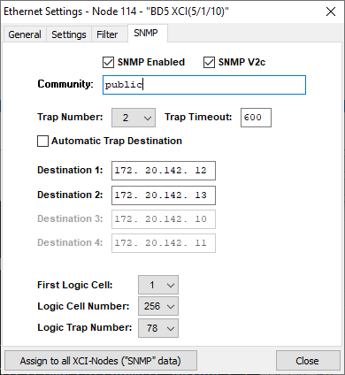
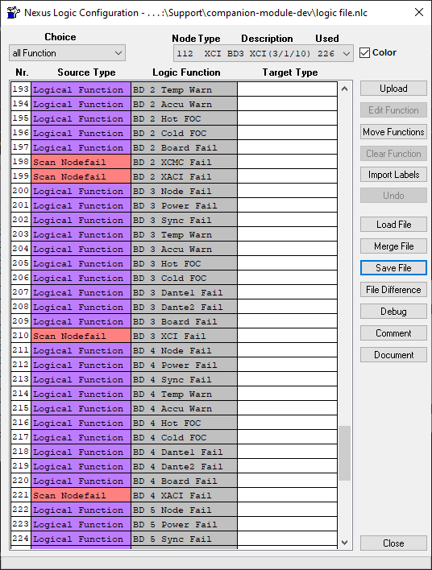

## Stagetec Nexus XCI

- [Stagetec XCI](https://www.stagetec.com/en/nexus-modular.html)

This module is an system monitor amd SNMP trap receiver optimised for the logic configurable traps from the Stagetec Nexus XCI. It allows boolean feedbacks to be created and used to trigger events in Companion based on logic configured in Nexus Service.

Each XCI card is capable of 256 logic configurable SNMP traps. NB. In the test system the 256th logic cell doesn't report an OID correctly.

### Configuration

**XCI IP**

The IP of the XCI card. Any traps received from other IPs will be ignored.

**Community String**

The community string set on the XCI. Any traps received with a non-matching community will be ignored. It is also used to read the state of the logic cells.

**SNMP Version**

The SNMP version set on the XCI, v1 or v2c. Traps are received in either, but the XCI is read in this version.

**SNMP Agent Port**

The port the XCI answers SNMP requests on, normally 161.

**Status Poll Interval (s)**

How often the Nexus status (project, base devices, trap destinations and errors) is read, 10 seconds by default. 0 reads it only when the module starts, when its config changes, and with the Refresh action.

### XCI Configuration

Configuring the XCI to trigger SNMP traps requires use of Nexus Service.

In the ethernet configuration window select the XCI card and navigate to the SNMP tab.

Ensure SNMP is enabled. Set the community string and the trap number to at least one. One of the destination IPs should be the host IP of the Companion computer. This module will work regardless in either v1 or v2c mode.

SNMP traps will only be triggered from logic cells according to the settings in "First Cell Number", "Logic Cell Number" and "Logic Trap Number".

Logic configuration to trigger the traps is then done in the Logic section of Nexus Service.

Both the network settings and logic configuration must be uploaded to the Nexus system once the respective changes are made.

### Note on use

When the module starts, and whenever its config is changed, it reads the state of all 256 logic cells from the XCI. A cell found true also sets its latch, but is not counted, and does not change the Most Recent Trigger variable: those follow traps only. After that, the cells follow their traps.

The rest of the Nexus status is read at the same time, then every poll interval. Errors are also kept up to date between polls by the XCI's error traps.

If the XCI does not answer, the connection shows a warning, and each cell stays false until its next trap. Once the XCI answers a status read, the cells are read again and the warning clears. With a Status Poll Interval of 0 there are no further status reads, so press Refresh instead. Everything the module reads is read-only: SNMP can't change anything on the Nexus.

### Actions

- **Reset Count**

Reset the specified count variable to zero.

- **Reset Latch**

Reset the specified latch variable to false.

- **Refresh**

Read the logic cells and the Nexus status from the XCI now.

### Variables

- **Logic Cell Count [ 1 - 256 ]**

Increments when an SNMP trap is received setting the cell to true.

- **Logic Cell Latch [ 1 - 256 ]**

Goes true when an SNMP trap is received setting the cell to true. Stays true until reset.

- **Most Recent Trigger**

Returns the cell number of the most recently received true SNMP trap.

The rest are named after the objects in the XCI's MIB (MATRIX5-MIB). Each is empty until read, or if the XCI doesn't report it.

- **Project:** `projectName`, `projectRevision` (firmware revision), `baseDevNum` (base devices configured), `baseDevOnline` (base devices online), `syncSources`, `syncIndex` (the current sync source, 0 for internal)
- **XCI:** `hostName`, `deviceType`, `moduleName` and `moduleVersion` (the MIB the XCI implements)
- **Logic signals:** `firstSignal`, `configSignals` (how many are configured), `trapSignals` (how many have traps)
- **Traps:** `trapDestinations`, `trapDestAuto`, `trapTimeout`, and `trapAddresses`, the destination IPs separated by commas
- **Errors:** `activeErrors` (how many), `activeErrorNames` (separated by commas), and `lastErrorNode`, `lastErrorCode`, `lastErrorName` and `lastErrorParam` for the error that most recently occurred, even once removed
- **Each base device**, by its node number N: `deviceOnline_N`, `configBoards_N`, `availBoards_N`, `powerUnits_N`, `pwrGoodUnits_N`, `cpuTemperature_N` and `cpuMaxTemp_N` (the highest since cold boot), in °C. These appear once the XCI has been read

### Feedbacks

- **XCI SNMP Trap**

Follows the state of the specified SNMP trap.

- **XCI SNMP Trap - Latched**

Goes true when triggered by a trap. Stays true until reset.

- **Sync Source**

True while the Nexus is synced to the source given, 0 for the internal clock.

The health feedbacks are value feedbacks, for use in expressions, local variables and layered buttons. Unlike the variables, they take the device, node or code as an option, so it can come from an expression.

- **Base Device Health**

One value from a base device: online, configured or available boards, whether every configured board is available, power units or working power units, whether every power unit works, or the CPU temperature now or its highest since cold boot. Empty for a device the XCI hasn't reported.

- **System Health**

Whether every base device is online, every configured board available, or every power unit working; the hottest CPU temperature; or the number of active errors.

- **Active Errors**

The number of active errors, optionally only from one node (0 for any) or with one error code.

### Presets

- **Health: Base Device Health**

One button per base device: its node number, whether it is online, its available and configured boards, its working and fitted power units, and its CPU temperature, with a gauge. A light beside the online state is green when all is well, amber when a board is missing, a power unit has failed or the CPU has reached its warning temperature, red when the device is offline, and grey until the XCI has been read.

The warning temperature is the button's `warnTemperature` local variable. It starts at 55°C, where Nexus Service warns for an XCPU.

Once the XCI has been read, the preset is listed for each base device it reports. Until then it is offered for device 1. The button's `device` local variable picks the device, so it can be changed after placing.
